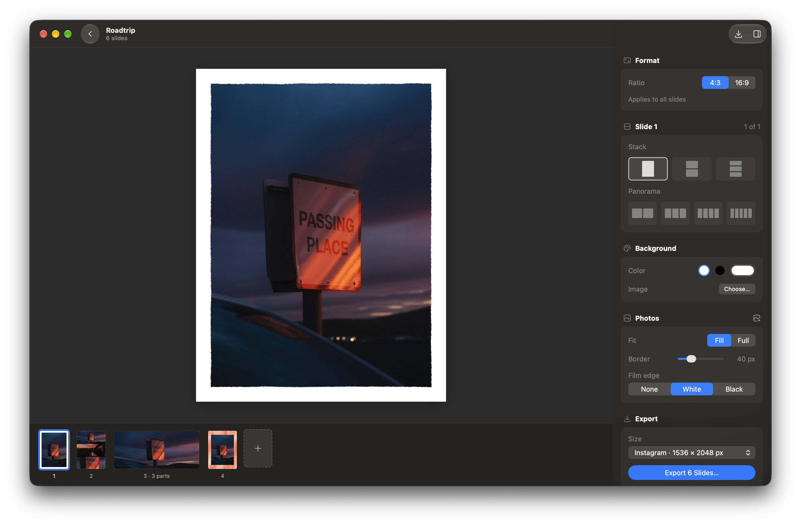

# Slides

A native macOS editor for Instagram-style photo and video carousels.



## Install

```sh
brew install --cask yannickpulver/tap/slides
```

Slides updates itself through Sparkle. It needs macOS 26 or later.

## Features

- Drop photos and videos onto a slide, or click a slot to pick files
- One, two or three stacked photos per slide, or a panorama across 2 to 5 slides
- Pan and zoom each photo; it always covers its slot
- Background color or blurred background image, gap and border
- Thin film-gate edge in white or black
- Free text like in Figma: press T and click (or drag for a wrapping width), move with snapping, double-click to edit; any installed font
- Export as PNG (1x, 2x, 3x) or MP4 with the audio of the first video
- Exported files are dated one second apart, so apps keep the order

## MCP

While Slides runs, agents like Claude Code can control it over MCP: open and create projects, add photos and text, change layouts and styles, render slides and export. Edits show up live and undo with ⌘Z.

```sh
claude mcp add --transport http slides http://127.0.0.1:47100/mcp
```

The command is also under Slides › Copy MCP Setup Command. The server only listens on this Mac. Debug builds use port 47101.

## Development

```sh
cd macos
tuist install && tuist generate
```

`SlidesCore` holds the model, layout, renderer and export. Its tests run with `swift test` in `macos/SlidesCore`.

A release builds when `VERSION` changes on `main`.

## License

MIT
